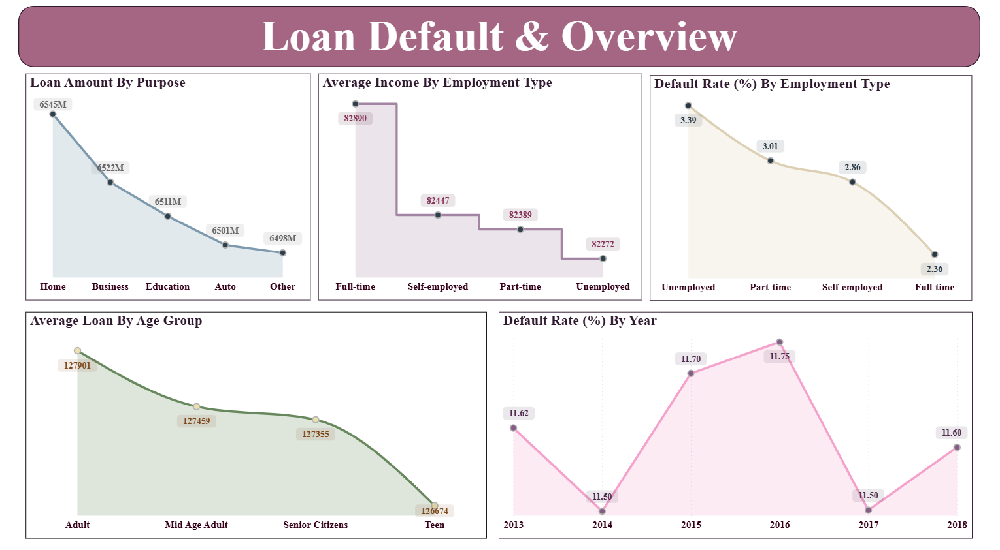
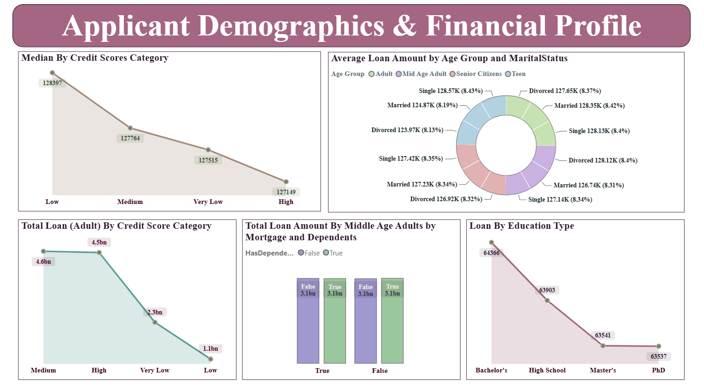
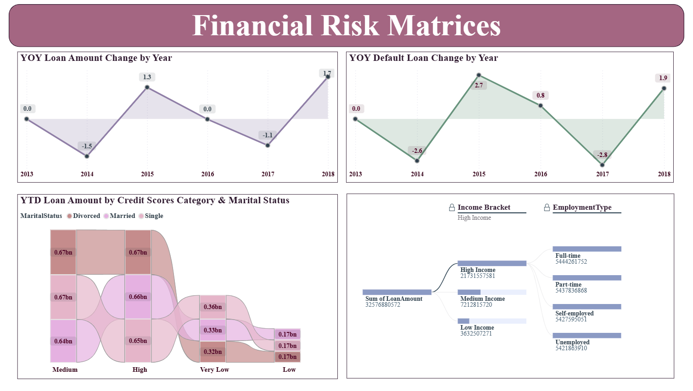

# 🏦 Loan Default Analysis Dashboard | SQL Server & Power BI

An end-to-end data analytics project focused on analyzing loan defaults, borrower demographics, financial profiles, credit scores, and lending patterns. The project uses SQL Server for database creation and data exploration, with Power BI for interactive reporting and visualization of loan amounts, default rates, income, employment types, and borrower risk indicators.

---

## Table of Contents

- [About the Project](#about-the-project)
- [Technologies Used](#technologies-used)
- [Dataset](#dataset)
- [Project Objectives](#project-objectives)
- [Project Workflow](#project-workflow)
- [SQL Analysis](#sql-analysis)
- [Power BI Dashboard](#power-bi-dashboard)
- [Key Findings](#key-findings)
- [Business Recommendations](#business-recommendations)
- [How to Run](#how-to-run)
- [Project Structure](#project-structure)
- [Future Improvements](#future-improvements)
- [Author](#author)

---

## About the Project

The objective of this project is to explore loan data and develop an interactive Power BI dashboard to understand loan default patterns, borrower characteristics, and financial risk indicators.

The dashboard analyzes loan amounts by purpose, average income by employment type, default rates by employment type and year, and loan distribution across age groups. Additional report pages explore credit score categories, education, marital status, mortgage information, and dependents.

SQL Server is used to create the database and retrieve the loan dataset, while Power BI presents the data through interactive visualizations that help users investigate lending patterns and potential risk factors.

This project demonstrates practical skills in SQL querying, database exploration, data visualization, financial data analysis, and business intelligence reporting.

---

## Technologies Used

- **SQL Server** — database creation, data access, and data exploration.
- **SQL Server Management Studio (SSMS)** — executing SQL queries and managing the database.
- **Microsoft Power BI Desktop** — interactive dashboard development and data visualization.
- **SQL** — database selection and retrieving records using `SELECT`.
- **Power Query and DAX** — data transformation and calculations, where implemented in the report.

---

## Dataset

The project uses a loan dataset stored in the SQL Server table `Loan_default`.

The dataset supports analysis of loan defaults, loan amounts, borrower demographics, employment information, credit scores, and financial characteristics.

### Key Analytical Fields

| Field / Metric | Purpose |
|---|---|
| Loan Amount | Analyze loan distribution across different categories. |
| Loan Purpose | Examine loan amounts by purpose. |
| Default Status | Analyze default patterns within the dataset. |
| Employment Type | Compare average income and default rates across employment categories. |
| Income | Examine borrower income characteristics. |
| Age Group | Compare loan amounts across borrower age groups. |
| Credit Score Category | Analyze loan distribution and median credit scores across categories. |
| Education Type | Examine loan amounts by education category. |
| Marital Status | Explore loan amounts across marital status categories. |
| Mortgage and Dependents | Investigate loan distribution across borrower financial and household characteristics. |
| Year | Examine annual default rates and year-to-date loan amounts. |

**Data note:** The fields above reflect the analytical dimensions shown in the Power BI report. The exact source column names, dataset size, date range, and data-cleaning operations should be verified against the original dataset before being documented.

---

## Project Objectives

- Create a SQL Server database for loan data analysis.
- Retrieve and explore the loan dataset.
- Analyze loan amounts across different loan purposes.
- Compare average income and default rates by employment type.
- Examine default rate trends across years.
- Analyze loan distribution across borrower age groups.
- Investigate credit score categories and their relationship with lending patterns.
- Explore loan amounts by education, marital status, mortgage, and dependents.
- Develop an interactive Power BI dashboard to communicate financial and borrower insights.

---

## Project Workflow

1. **Database Creation:** Created the `LOAN` database in SQL Server.
2. **Database Selection:** Selected the database using the `USE` statement.
3. **Data Exploration:** Retrieved records from the `Loan_default` table.
4. **Data Preparation:** Prepared the dataset for reporting using the applicable data preparation steps.
5. **Loan Analysis:** Examined loan amounts by purpose and borrower age group.
6. **Default Analysis:** Visualized default rates by employment type and year.
7. **Demographic Analysis:** Explored borrower characteristics, including education, credit scores, and marital status.
8. **Financial Analysis:** Examined income, mortgage, dependents, and lending patterns.
9. **Visualization:** Developed a multi-page Power BI dashboard to present the analysis.

---

## SQL Analysis

The current SQL script covers database creation, database selection, and initial data exploration.

### 1. Create the Database

```sql
CREATE DATABASE LOAN;

USE LOAN;
```

Creates the `LOAN` database and selects it for subsequent SQL operations.

### 2. Retrieve Loan Records

```sql
SELECT *
FROM [dbo].[Loan_default];
```

Retrieves all columns and records from the loan dataset for inspection and exploration.

### SQL Skills Demonstrated

- Database creation using `CREATE DATABASE`.
- Database selection using `USE`.
- Data retrieval using `SELECT`.
- Accessing tables through schema-qualified names.
- Initial dataset inspection.

**Note:** The SQL script currently provided contains basic data exploration queries. The advanced aggregations, default-rate calculations, and demographic comparisons described in the Power BI section should not be attributed to SQL unless corresponding queries are added to the project.

---

## Power BI Dashboard

The Power BI report contains three pages focused on loan performance, borrower demographics, and financial risk analysis.

### 1. Loan Default & Overview

This page provides an overview of loan amounts, income, and default patterns across different borrower categories.

**Visualizations include:**

- Loan Amount by Purpose
- Average Income by Employment Type
- Default Rate (%) by Employment Type
- Average Loan by Age Group
- Default Rate (%) by Year

**Analytical focus:**

- Compare loan amounts across different purposes.
- Examine average income across employment types.
- Investigate differences in default rates across employment categories.
- Compare average loan amounts across age groups.
- Analyze how default rates vary by year.

### 2. Applicant Demographics & Financial Profile

This page explores borrower characteristics and financial information through credit score, education, age-related, mortgage, and dependent categories.

**Visualizations include:**

- Median by Credit Score Category
- Total Loan by Adult Credit Score Category
- Total Loan Amount by Middle-Aged Adults, Mortgage, and Dependents
- Loan by Education Type

**Analytical focus:**

- Examine median credit score values across categories.
- Compare loan amounts across credit score categories.
- Investigate loan distribution by borrower age and household characteristics.
- Analyze loan amounts across education categories.

### 3. Financial Risk Matrices

This page includes a year-to-date loan amount visualization segmented by credit score category and marital status.

**Visualization includes:**

- YTD Loan Amount by Credit Score Category and Marital Status

**Analytical focus:**

- Compare year-to-date loan amounts across credit score categories.
- Explore lending patterns across marital status groups.
- Examine how the selected borrower categories contribute to the displayed loan amounts.

### Dashboard Screenshots

Add screenshots of your actual Power BI report pages to the `screenshots/` folder in your GitHub repository.

#### Loan Default & Overview



#### Applicant Demographics & Financial Profile



#### Financial Risk Matrices



**Note:** The image references are placeholders. Capture screenshots of the actual report pages, save them using these filenames, and commit the image files to GitHub.

---

## Key Findings

The dashboard supports investigation of the following business questions:

- Which loan purposes account for the largest loan amounts?
- How does average income vary across employment types?
- How do default rates differ across employment categories?
- How have default rates changed over the years represented in the dataset?
- How do average loan amounts vary across age groups?
- How are loan amounts distributed across credit score categories?
- How do education, marital status, mortgage, and dependents relate to lending patterns?

Actual findings should be added after reviewing the dashboard values. Numerical claims about default rates, borrower risk, or the highest-performing categories should be verified against the report before publication.

---

## Business Recommendations

The dashboard can support the following potential business actions, depending on the verified results:

- **Default monitoring:** Review employment categories and periods with elevated default rates to identify areas requiring further investigation.
- **Credit risk assessment:** Examine credit score categories alongside loan distribution to understand lending exposure.
- **Loan portfolio analysis:** Compare loan amounts across different purposes to understand the distribution of lending activity.
- **Borrower segmentation:** Use age groups, education, income, and employment characteristics to investigate differences in the borrower population.
- **Financial risk monitoring:** Explore mortgage and dependent categories alongside loan amounts to identify patterns that merit additional analysis.
- **Trend analysis:** Monitor annual default rates to identify changes that may require further investigation.

These are potential recommendations, not confirmed business outcomes. The dashboard alone does not establish causation or prove that any particular borrower characteristic causes loan default.

---

## How to Run

### 1. Clone the Repository

```bash
git clone https://github.com/HaravdeAakanksha/Loan-Default-Analysis-Dashboard.git
```

Alternatively, download the repository as a ZIP file from GitHub and extract it.

### 2. Set Up SQL Server

Open SQL Server Management Studio and connect to your SQL Server instance.

Create the database by executing:

```sql
CREATE DATABASE LOAN;

USE LOAN;
```

Ensure that the `Loan_default` table has been imported into the database before running the data retrieval query.

### 3. Execute the SQL Script

Run the SQL queries in SQL Server Management Studio.

Verify that the database and table names match those referenced in the script.

### 4. Open the Power BI Report

Open the project's `.pbix` file using Microsoft Power BI Desktop.

If the report prompts you to reconnect to a data source, update the file path or database connection settings as required.

### 5. Refresh and Explore the Dashboard

Refresh the dataset if necessary and navigate through all three report pages.

Explore the available visualizations to compare loan amounts, default rates, income, credit score categories, and borrower demographics.

### 6. Add Screenshots to GitHub

1. Open the report in Power BI Desktop.
2. Navigate to each report page.
3. Capture a clear screenshot of the page.
4. Save the screenshots in the `screenshots/` folder.
5. Update the README image references if necessary.
6. Commit and push the README and screenshots to GitHub.

---

## Project Structure

```text
Loan-Default-Analysis-Dashboard/
│
├── README.md
├── Loan Power BI Report.pbix
│
├── data/
│   └── Loan_default.csv
│
├── sql/
│   └── Loan_Analysis.sql
│
└── screenshots/
    ├── loan-default-overview.png
    ├── applicant-demographics-financial-profile.png
    └── financial-risk-matrices.png
```

**Note:** This is a suggested structure. Keep the actual filenames and folders from your GitHub repository. The dataset and SQL filenames shown here are examples, not confirmation that those files are present.

---

## Future Improvements

- Add a total record count and document the dataset's date range.
- Implement SQL queries for default counts, default rates, and loan amount aggregations.
- Document the DAX measures and calculated fields used in Power BI.
- Add data-quality checks for missing values, duplicate records, and invalid values.
- Include verified numerical findings and business insights.
- Add additional KPIs for loan portfolio performance and default monitoring.
- Introduce period-over-period comparisons where the available date fields support them.
- Improve dashboard navigation and add drill-through analysis where appropriate.

---

## Author

**Aakanksha Haravde**

Aspiring Data Analyst | SQL Server | Power BI | Data Analytics | Business Intelligence
